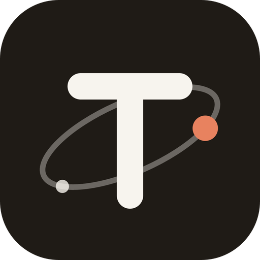

<div align="center">



# Tramion

**Notas e bases de dados que moram no seu computador.**
Um aplicativo desktop _local-first_ no estilo do Notion: páginas com editor de blocos, subpáginas, bases de dados
com cinco formas de exibição, e nenhum servidor, cadastro ou internet.


[Funcionalidades](#funcionalidades) ·
[Instalação](#instalação) ·
[Como usar](#como-usar) ·
[Desenvolvimento](#desenvolvimento) ·
[Arquitetura](#arquitetura) ·
[Roadmap](#roadmap)

</div>

---

## Por que o Tramion

O nome vem de _trama_: o que liga as ideias. A proposta é um espaço de anotações e organização pessoal que seja
**bonito, rápido e seu**:

- **Local-first.** Tudo fica em um banco SQLite na pasta do seu usuário. Funciona 100% offline, sem conta e sem
  telemetria.
- **Parecido com o Notion** onde importa: editor de blocos, menu `/`, subpáginas, ícone e capa, bases de dados.
- **Cuidadoso com os seus dados.** Backup automático antes de qualquer atualização do banco, detecção de conflito de
  edição e validação de tudo o que entra (links, imagens, valores).
- **Modular.** Cada funcionalidade é um módulo com fronteiras verificadas por ferramenta, o que mantém o código
  fácil de evoluir.

## Funcionalidades

### Páginas e editor

- Editor de **blocos** (títulos, listas, tarefas, citações, tabelas, alternáveis) com menu `/` e apelidos em português.
- **Subpáginas** que aparecem no texto como links, árvore na barra lateral, mover, favoritar e reordenar.
- **Menções** a outras páginas com `@`.
- **Código** com seleção de linguagem, cores de sintaxe e **detecção automática da linguagem** ao colar.
- **Imagens, vídeo e áudio** (por arquivo ou por link), cartão de **link** e **vídeos do YouTube e do Vimeo** na página.
- **Ícone (emoji) e capa** em cada página (degradês, cores, imagem enviada ou por link).
- Menu do bloco com **Transformar em**, cores e excluir.
- Salvamento automático, com aviso de conflito se a página mudar em outro lugar.
- **Busca global** (`Ctrl + K`) no título e no texto, sem diferenciar acento; **duplicar página**, **modelos** de página e **exportar/importar Markdown**.
- **Lixeira** com restaurar, apagar de vez e **esvaziar lixeira**.
- Tema **claro, escuro ou automático** e barra lateral recolhível (`Ctrl + \`).

### Bases de dados

- Uma base é uma coleção de páginas: cada **linha é uma página** completa (texto, blocos, ícone, capa).
- **Colunas tipadas:** texto, número, seleção, seleção múltipla, data, caixa de seleção e link.
- **Cinco formas de exibição:** tabela, quadro (Kanban), lista, galeria e calendário (mês e semana), com **várias visões salvas** por base.
- **Filtros** (combinados) e **ordenação** em todas as formas de exibição; arrastar cartões no quadro e itens no calendário.
- **Lembretes de tarefas:** o que está atrasado ou vence hoje aparece na barra lateral, com um aviso diário do sistema.
- Páginas de **exemplo** na primeira abertura (guia, lista de tarefas, leituras e diário).

## Instalação

> Os instaladores ficam na página de [**Releases**](../../releases) do repositório.

| Sistema | Arquivo                                          | Observação                                   |
| ------- | ------------------------------------------------ | -------------------------------------------- |
| Linux   | `.deb` (Debian, Ubuntu e derivados), `.AppImage` | Testado no Linux; é o sistema de referência. |
| Windows | `.msi` ou `.exe`                                 | Ainda não validado em uso real.              |
| macOS   | `.dmg`                                           | Ainda não validado em uso real.              |

- Os instaladores **não são assinados**: o Windows (SmartScreen) e o macOS (Gatekeeper) vão avisar que o autor é
  desconhecido. É esperado nesta fase.
- No Linux com `.deb`: `sudo apt install ./Tramion_*_amd64.deb`.
- Para **compilar a partir do código**, veja [Desenvolvimento](#desenvolvimento).

### Onde ficam os seus dados

| Sistema | Pasta                                            |
| ------- | ------------------------------------------------ |
| Linux   | `~/.local/share/dev.tramion.app/`                |
| Windows | `%APPDATA%\dev.tramion.app\`                     |
| macOS   | `~/Library/Application Support/dev.tramion.app/` |

Dentro dela: o banco (`tramion.db`), os arquivos enviados (`assets/`) e as cópias de segurança (`backups/`). **Para fazer
backup, copie essa pasta com o app fechado.** Nada é enviado para fora do computador (imagens, vídeos e cartões de link
adicionados _por endereço_ são carregados do site de origem, como em qualquer navegador).

## Como usar

1. **Abra o Tramion.** Na primeira vez, você encontra páginas de exemplo na barra lateral.
2. **Crie páginas** com o botão de nova página. Digite `/` para inserir blocos e `@` para mencionar outra página.
3. **Crie uma base de dados** com o botão de tabela da barra lateral (ou `/` e _Base de dados_). Adicione colunas
   com o **+** do cabeçalho e troque a forma de exibição pelas abas _Tabela, Quadro, Lista, Galeria e Calendário_.
4. **Organize:** arraste blocos pela alça, mova páginas pelo menu "⋯", favorite as mais usadas.

**Atalhos:** `Ctrl + K` busca em todas as páginas · `Ctrl + \` recolhe a barra lateral · `Ctrl + B` / `Ctrl + I` negrito e itálico · `Tab` / `Shift + Tab`
recuam itens de lista · `/` insere blocos · `@` menciona páginas.

## Desenvolvimento

### Requisitos

- **Node.js** 22 ou superior e **pnpm** 12 (`corepack enable`).
- **Rust** estável (edição 2024).
- Bibliotecas do Tauri 2 para o seu sistema: veja o [guia oficial de pré-requisitos](https://tauri.app/start/prerequisites/).
  No Debian/Ubuntu:

  ```bash
  sudo apt install build-essential curl wget file libxdo-dev libssl-dev \
    libwebkit2gtk-4.1-dev libayatana-appindicator3-dev librsvg2-dev
  ```

### Comandos

```bash
pnpm install                                # dependências
pnpm --filter @tramion/desktop tauri dev    # abre o app em modo de desenvolvimento
pnpm check                                  # lint + formatação + tipos + testes (TypeScript e Rust)
pnpm test                                   # só os testes de TypeScript
pnpm --filter @tramion/desktop tauri build  # gera os instaladores (em target/release/bundle/)
```

O projeto tem **centenas de testes** (Vitest e Testing Library no TypeScript, testes de integração com SQLite no
Rust). Veja [docs/development.md](docs/development.md) para o dia a dia, [docs/conventions.md](docs/conventions.md) para
as convenções e [docs/releasing.md](docs/releasing.md) para publicar uma versão.

## Arquitetura

Monorepo (pnpm workspaces + Cargo workspace) com **fronteiras entre módulos verificadas pelo lint**:

```text
apps/desktop            casca do aplicativo (Tauri + React) e raiz de composição
packages/contracts      tipos e contratos compartilhados
packages/core           barramento de eventos tipado e registro de módulos
packages/ui             sistema de design (tokens, ícones, menu, janelas)
packages/infra-sqlite   SQLite com migrações versionadas, backup e verificação
modules/notes           módulo de notas e bases de dados (TypeScript + crate Rust)
docs/                   produto, arquitetura, convenções e decisões (ADRs)
```

- **Módulos independentes:** um módulo só importa `contracts`, `core` e `ui`, e conversa com os demais por **eventos**.
- **Regras no Rust:** validação, hierarquia de páginas, conflito de versão e tipos das colunas moram no backend,
  testadas contra um SQLite em memória; a interface só traduz o que o Rust decide.
- **Migrações só para a frente**, com resumo (checksum) conferido, backup automático antes de migrar e verificação de
  integridade.
- **Segurança:** links abrem só em `http` e `https`; arquivos enviados são validados por tipo, assinatura e tamanho;
  a política de segurança de conteúdo do app libera apenas o necessário.

As decisões estão registradas em [docs/adr](docs/adr/) (16 registros até agora). Para a visão geral, comece por
[docs/architecture.md](docs/architecture.md).

## Roadmap

- [x] Editor de blocos, subpáginas, menções, ícone e capa
- [x] Bases de dados: tabela, quadro, lista, galeria e calendário
- [x] Lixeira, páginas de exemplo, temas claro e escuro
- [x] Notificações de tarefas (lembretes de prazos, com aviso diário do sistema)
- [x] Busca global (`Ctrl + K`)
- [x] Filtros e várias visões salvos por base; calendário semanal
- [x] Exportar e importar Markdown
- [x] Modelos de página e duplicar página
- [ ] Lembretes com o app fechado (ícone na bandeja)
- [ ] Modelos criados pela pessoa e busca no conteúdo das bases
- [ ] Validação e instaladores assinados para Windows e macOS

## Contribuindo

Sugestões e correções são bem-vindas. Antes de abrir um _pull request_, rode `pnpm check` (precisa passar sem
avisos) e leia as [convenções](docs/conventions.md) e os [ADRs](docs/adr/) relacionados à área que vai mexer.

## Licença

[MIT](LICENSE): você pode usar, copiar, modificar e distribuir, inclusive comercialmente, mantendo o aviso de direitos autorais.

## Agradecimentos

[Tauri](https://tauri.app/), [React](https://react.dev/), [BlockNote](https://www.blocknotejs.org/),
[SQLite](https://sqlite.org/), [highlight.js](https://highlightjs.org/), e as fontes
[Fraunces](https://fonts.google.com/specimen/Fraunces) e [Inter](https://rsms.me/inter/) (licença OFL).
